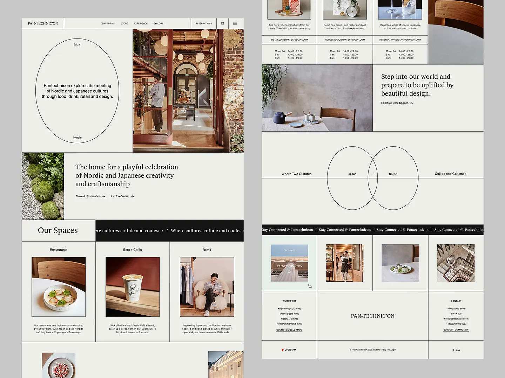
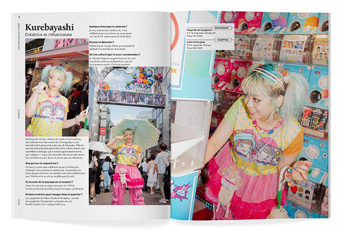

# Product Requirements Document (PRD)
# Farhan's Portfolio — Japanese Editorial Redesign

**Version:** 1.0  
**Project:** Personal Portfolio Website  
**Product Owner:** Farhan Adiwidya Pradana  
**Project Type:** Existing Website Redesign  
**Status:** Ready for Implementation  
**Implementation Platform:** Existing Next.js / React Codebase

---

## 1. Executive Summary

This project aims to redesign Farhan Adiwidya Pradana's existing personal portfolio website into a visually distinctive, Japanese editorial-inspired digital experience.

The existing portfolio successfully presents technical projects, professional experience, education, and personal interests. However, its visual language remains relatively conventional, with text-heavy sections, repetitive layouts, small project visuals, and a corporate developer-portfolio aesthetic.

The redesign should transition the website toward an **image-led editorial experience inspired by Japanese independent magazines, Harajuku visual culture, and experimental graphic design**.

The redesigned website should balance professional credibility with creative personality, presenting Farhan's interests in Data Science, Artificial Intelligence, Data Engineering, anime, and automotive culture.

**Core design principle:**

> Make the website feel like a carefully art-directed personal magazine, rather than a conventional digital résumé.

The redesign must preserve factual content, working functionality, and existing project information.

---

## 2. Problem Statement

### 2.1 Current State

Based on the existing portfolio screenshots, the website currently features:

- A dark, monochromatic interface.
- A text-dominant hero with a comparatively small portrait.
- Repetitive two-column project cards.
- Small technical screenshots and architecture diagrams.
- Large amounts of secondary metadata.
- Structured but visually repetitive experience entries.
- Frequent divider lines and section numbering.
- Consistent but predictable typography.

The existing design is functional and professional, but lacks the visual expression shown in the supplied editorial references.

### 2.2 Identified Problems

**P1 — Insufficient visual storytelling**

Project imagery is relatively small and often subordinate to textual explanations.

**P2 — Repetitive section layouts**

Most sections follow similar grid, heading, divider, and content patterns, reducing visual variety.

**P3 — Generic developer-portfolio styling**

Small uppercase labels, technical metadata, simple borders, and repeated card arrangements create a familiar AI-generated portfolio appearance.

**P4 — Limited personal expression**

Farhan's interests in anime, Japanese visual culture, and automotive design are mentioned but not meaningfully reflected in the website's visual identity.

**P5 — Weak visual hierarchy between imagery and text**

The current design distributes attention relatively evenly across elements instead of using imagery and typography to create distinct focal points.

---

## 3. Product Goals

### Primary Goals

**G1. Establish a distinctive editorial visual identity**

Create a design language inspired by contemporary Japanese magazines and experimental editorial layouts.

**G2. Increase visual emphasis on imagery**

Use large photographs, authentic project visuals, and thoughtfully composed image arrangements to communicate content.

**G3. Improve typography**

Introduce stronger display typography alongside quieter, understated supporting text.

**G4. Reduce repetitive design patterns**

Use controlled variation in section compositions while maintaining a consistent overall visual system.

**G5. Communicate personality**

Subtly incorporate interests in anime, Japanese visual culture, and automotive design without compromising professionalism.

**G6. Preserve professional credibility**

Ensure technical recruiters, consulting firms, and potential collaborators can easily understand Farhan's experience and work.

### Non-Goals

The redesign is NOT intended to:

- Rebuild the website from scratch unnecessarily.
- Change its core technology stack.
- Rewrite the entire CV.
- Remove important achievements or projects.
- Introduce an unrelated backend.
- Turn the website into an anime fan page.
- Create a racing-themed interface.
- Introduce visually impressive but inaccessible interactions.

---

## 4. Target Audience

### Primary Audience

**Technology recruiters and hiring managers**

Interested in technical competencies, projects, professional experience, and academic qualifications.

**Engineering and data professionals**

Interested in project architecture, methodologies, technologies, and implementation details.

### Secondary Audience

**Consulting firms and business-oriented organizations**

Interested in analytical thinking, business problem-solving, leadership, and communication skills.

**Potential collaborators and professional connections**

Interested in learning about Farhan's personality, interests, background, and projects.

### Primary User Journey

1. Visitor lands on the homepage.
2. A visually distinctive hero communicates Farhan's identity.
3. Visitor explores image-led project showcases.
4. Visitor reviews relevant technical projects and professional achievements.
5. Visitor discovers experience, education, and interests.
6. Visitor connects through GitHub, LinkedIn, or email.

---

## 5. Design References

### Reference A — Japanese Minimalist Editorial

**Asset: ** 

Use this reference for:

- Minimalist typography.
- Monochromatic layouts.
- Strong alignment.
- Asymmetrical content placement.
- Editorial spacing.
- Fine divider lines.
- Clear visual hierarchy.

### Reference B — Kyoto Editorial Collage

**Asset: ** New Kyoto editorial reference image supplied by the product owner.

Use this reference for:

- Large black-and-white photography.
- Layered imagery.
- Botanical line-art aesthetics.
- Cobalt-blue graphic accents.
- Halftone print textures.
- Creative image cropping.
- Small editorial body text.
- Experimental yet balanced composition.

### Reference C — Harajuku Magazine Website

**Asset:https://dribbble.com/search/harajuku** New Harajuku website reference supplied by the product owner.

Use this reference for:

- Oversized photography.
- Asymmetric image placement.
- Bold headlines.
- Bright, carefully controlled accents.
- Overlapping image layers.
- Magazine-inspired layouts.
- Playful editorial composition.

### Reference Priority

1. Supplied Kyoto and Harajuku references for visual expression.
2. `reference.jpeg` for typography and structural restraint.
3. Existing portfolio for content, functionality, and professional identity.

**Requirement:** Codex must visually inspect the available reference files, not merely infer their appearance from their filenames.

If any assets are unavailable, report them accurately.

---

## 6. Design System Requirements

### 6.1 Visual Identity

**Design direction:** Japanese editorial minimalism meets contemporary youth-culture magazine design.

The aesthetic should be:

- Image-led.
- Typography-driven.
- Asymmetrical but balanced.
- Creative but professional.
- Personal rather than corporate.
- Minimalist without being empty.
- Expressive without being chaotic.

### 6.2 Color Palette

| Role | Color | Hex |
|---|---|---|
| Primary background | Warm white | `#F8F7F4` |
| Primary text | Near-black | `#171717` |
| Secondary text | Muted gray | `#666666` |
| Borders | Light gray | `#DEDEDB` |
| Editorial accent | Cobalt blue | `#2459A6` |
| Secondary accent | Vermilion | `#F26332` |

**Requirements:**

- Use warm white as the preferred light-mode background.
- Preserve the existing dark-mode functionality.
- Keep accent colors selective.
- Avoid excessive gradient effects.
- Use larger color blocks only where compositionally appropriate.
- Maintain accessible text contrast.

### 6.3 Typography

**Display Typography**

Use a bold, modern sans-serif for major headlines.

Existing primary headline typography may be preserved if suitable.

**Body Typography**

Use an understated sans-serif with natural proportions and high readability.

**Secondary Typography**

Replace excessively stylized technical micro-labels with simple, editorial sans-serif typography.

Examples:

| Current Style | Preferred Style |
|---|---|
| `DATA / AI / ENGINEERING` | Data, AI & Engineering |
| `GET TO KNOW ME` | About me |
| `03 / AI & AUTOMATION` | 03 — AI & Automation |
| `LOCAL MVP` | Local prototype |

**Typography Requirements:**

- Avoid excessive letter spacing.
- Reduce unnecessary uppercase text.
- Use monospace typography sparingly.
- Preserve readable body-text sizes, generally 15–17px.
- Keep important metadata readable, generally 12–14px or larger.
- Avoid excessively small Japanese-style magazine text when it would harm accessibility.
- Maintain consistent hierarchy across desktop and mobile.

### 6.4 Spacing

Prefer content-rich editorial compositions rather than large empty sections.

Initial spacing targets:

| Element | Desktop | Mobile |
|---|---|---|
| Section vertical padding | 56–88px | 40–64px |
| Main content gap | 24–40px | 16–24px |
| Grid gap | 16–24px | 12–16px |
| Card internal padding | 16–24px | 16–20px |

These values are guidelines and should be refined visually.

Avoid unnecessary full-viewport sections.

**Important:** Negative space should support the composition rather than create visibly empty regions.

---

## 7. Functional and Design Requirements

### FR-01 — Hero Redesign

**Priority:** P0 — Critical

#### Current Problem

The existing hero has a large headline and a comparatively small portrait card, creating a text-dominant composition.

#### Required Changes

Create a visually expressive editorial hero.

The design should feature:

- A significantly larger personal photograph.
- Bold "Farhan." typography.
- An asymmetric arrangement of text and imagery.
- A compact professional introduction.
- Subtle supporting details.
- Clear access to projects and contact information.

#### Design Requirements

- The portrait should become a primary visual element.
- Explore layered typography and asymmetric image placement.
- Avoid unnecessary borders around the portrait.
- Use meaningful image cropping.
- Preserve a clear reading order.
- Keep important navigation and CTA buttons accessible.
- Avoid positioning text over busy areas of photographs.

#### Acceptance Criteria

- The portrait has substantially more prominence than in the current design.
- The hero is visually balanced without relying on excessive whitespace.
- The professional identity remains understandable immediately.
- The hero works at desktop and mobile widths.
- Existing CTA buttons remain functional.

---

### FR-02 — Image-Led Project Gallery

**Priority:** P0 — Critical

#### Current Problem

Project cards are arranged in repetitive two-column grids, with relatively small imagery and similar compositions.

#### Required Changes

Replace the uniform presentation of featured projects with an editorial gallery.

#### Proposed Structure

**Featured Project 01**

A large visual case study featuring prominent project imagery and concise supporting information.

**Featured Project 02**

An asymmetric image-and-text composition.

**Featured Project 03**

A distinct editorial composition using layered project imagery where appropriate assets exist.

**Remaining Projects**

A compact but visually coherent project gallery.

#### Design Requirements

- At least two featured projects must have clearly image-led layouts.
- Project imagery should be substantially larger than in the current implementation.
- Use real project screenshots, charts, workflow diagrams, or dashboard imagery.
- Preserve all project links.
- Keep project categories and technology information visible but understated.
- Avoid repetitive card designs.
- Maintain clear visual consistency between different compositions.

#### Project Assets

Prioritize genuine imagery from:

- Travel Booking Data Warehouse.
- NexaHub Marketing Performance Dashboard.
- Internship Intelligence.
- AutoSIEM.
- Maternal Health Risk Prediction.
- Other existing GitHub projects.

Do not fabricate dashboards, project results, or technical diagrams.

#### Acceptance Criteria

- Featured projects no longer resemble a uniform SaaS feature-card grid.
- Images are visually prominent and high-quality.
- Project titles remain easy to scan.
- Technology labels do not overpower project imagery.
- Project filtering continues to work.
- All project links remain functional.

---

### FR-03 — About Section

**Priority:** P1 — High

#### Objective

Transform the existing text-heavy About section into a more engaging editorial profile.

#### Requirements

- Preserve the existing introduction.
- Use an asymmetric layout.
- Highlight one strong personal statement.
- Keep supporting paragraphs compact.
- Integrate visual interest where appropriate.
- Preserve the three core professional themes:
  - Technology.
  - Business & Strategy.
  - Leadership.

Avoid repetitive generic cards.

#### Acceptance Criteria

- The section resembles an editorial profile rather than a list of SaaS features.
- Professional information remains complete and readable.

---

### FR-04 — Experience & Leadership

**Priority:** P1 — High

#### Objective

Preserve the strong information architecture of the existing experience timeline while refining its visual hierarchy.

#### Requirements

- Retain all existing roles, dates, and achievements.
- Use compact editorial chronology.
- Increase prominence of organization and role names.
- Reduce unnecessary metadata decoration.
- Maintain readable descriptions.
- Use subtle horizontal rules.
- Preserve clear distinctions between current and previous roles.

#### Acceptance Criteria

- All existing experience entries remain accessible.
- The timeline remains easy to scan.
- The section is visually consistent with the new editorial design.
- The redesign does not sacrifice readability for decorative effects.

---

### FR-05 — Education

**Priority:** P1 — High

#### Required Assets

- `UGM.png`
- `NTU.png`

These images have already been provided by the product owner.

#### Requirements

Display:

**Universitas Gadjah Mada**

Bachelor of Computer Science  
July 2024 – Present  
CGPA: 3.73 / 4.00

**Nanyang Technological University**

Summer Exchange — Information Technology and Entrepreneurship  
June 2026 – July 2026  
Grade: 4.79 / 5.00

#### Layout Requirements

- Use existing university image assets.
- Display institution logos prominently but proportionately.
- Preserve original logo colors.
- Maintain appropriate clear space around logos.
- Use elegant editorial typography.
- Avoid large decorative education cards.
- Ensure responsive behavior.

#### Acceptance Criteria

- Both university logos load correctly.
- Original logo proportions are preserved.
- All academic details remain accurate.
- Education entries are readable on mobile and desktop.

---

### FR-06 — Beyond the Code

**Priority:** P1 — High

#### Objective

Express Farhan's personality through an editorial feature dedicated to his hobbies.

#### Content Themes

**Anime & Japanese Animation**

Interest in anime, storytelling, character development, and Japanese animation.

**Automotive Culture**

Interest in cars, automotive design, engineering, performance, and car culture.

#### Visual Direction

Create a small magazine-inspired feature with two distinct visual compositions.

For anime:
- Manga-inspired editorial framing.
- Restrained print textures.
- Minimalist illustration details.
- Japanese graphic-design influence.

For automotive:
- Automotive photography where properly licensed.
- Motorsport-inspired typography.
- Technical publication layouts.
- Strong image cropping.

#### Constraints

- Do not fabricate favorite anime series or car brands.
- Avoid unlicensed anime artwork.
- Avoid generic stock photos where possible.
- Preserve a professional overall aesthetic.

#### Acceptance Criteria

- Both hobbies are clearly represented.
- The section feels personal rather than generic.
- Imagery carries more visual weight than long paragraphs.
- The section remains coherent with the broader website.

---

### FR-07 — Motion & Interaction

**Priority:** P2 — Medium

#### Requirements

Implement restrained interactions such as:

- Gentle image reveals.
- Small image zooms on hover.
- Smooth anchor navigation.
- Subtle link transitions.
- Lightweight layered-image movements where appropriate.

#### Constraints

- Avoid excessive parallax.
- Avoid distracting cursor effects.
- Avoid unnecessary loading animations.
- Support `prefers-reduced-motion`.
- Maintain keyboard accessibility.

---

## 8. Asset Management

### Existing Required Assets

- `reference.jpeg`
- `UGM.png`
- `NTU.png`
- Existing personal portrait
- Existing project screenshots
- Existing project diagrams

### New Editorial References

The product owner has supplied additional Kyoto and Harajuku references.

These must be added to the repository or made accessible to Codex before visual inspection.

### Asset Requirements

- Preserve original source images.
- Store website assets in organized directories.
- Optimize image loading.
- Use responsive image sizes.
- Maintain image aspect ratios.
- Avoid blurry upscaling.
- Provide accessible alternative text.
- Distinguish decorative imagery from meaningful content.
- Only use image assets with appropriate usage rights.

---

## 9. Technical Requirements

### Existing Technology

Retain the current application framework and architecture where practical.

Expected stack:
- Next.js.
- React.
- TypeScript.
- Tailwind CSS.
- Existing animation libraries.

Codex must verify the actual stack before implementation.

### Performance

Target:

- Lighthouse Performance score of 90+ on representative production pages where practical.
- Lighthouse Accessibility score of 90+.
- No unnecessary client-side dependencies.
- Efficient image loading.
- Minimal layout shifts.
- Appropriate lazy loading for below-the-fold images.

These are performance targets, not guaranteed scores.

### Accessibility

- Semantic heading hierarchy.
- Adequate text contrast.
- Functional keyboard navigation.
- Visible focus indicators.
- Descriptive image alt text.
- Reduced-motion support.
- Accessible mobile navigation.

### Responsive Design

Test at representative viewport widths:

- 375px — Mobile.
- 768px — Tablet.
- 1440px — Desktop.

Ensure editorial compositions are appropriately rearranged on smaller screens rather than merely scaled down.

---

## 10. Content Preservation Requirements

The redesign must preserve:

- Personal profile.
- Professional experience.
- Leadership experience.
- Education.
- Technical skills.
- GitHub projects.
- Project descriptions and links.
- Research and achievements.
- Contact information.
- Anime and automotive interests.

Do not invent or exaggerate:

- Awards.
- Experience.
- Technical skills.
- Project performance.
- Project deployment status.
- Academic qualifications.

Any proposed copy changes must improve clarity without altering factual meaning.

---

## 11. Success Metrics

The redesign will be considered successful when:

| Metric | Target |
|---|---|
| Visual identity | Clearly Japanese editorial-inspired |
| Featured projects | At least 2 distinct image-led compositions |
| Hero | Portrait is a prominent editorial element |
| Typography | Reduced generic uppercase/monospace styling |
| Layout | Meaningful variation between major sections |
| University logos | Both display correctly |
| Functionality | All existing major features preserved |
| Mobile | No unintended horizontal overflow |
| Accessibility | Accessible interaction and readable contrast |
| Build | Production build completes successfully |

### Subjective Design Evaluation

The final website should pass these questions:

1. Does it feel like an independent editorial publication rather than a SaaS landing page?
2. Are authentic images an important part of the visual storytelling?
3. Does the typography have a clear hierarchy?
4. Are the compositions varied but cohesive?
5. Is Farhan's professional background still immediately understandable?
6. Does the site reflect genuine personality?
7. Does the design feel intentional rather than randomly decorative?

---

## 12. Implementation Roadmap

### Phase 1 — Discovery & Audit

**Tasks:**

- Inspect the codebase.
- Identify current reusable components.
- Inspect all reference images.
- Audit typography and spacing.
- Identify image assets.
- Record current functionality and content.

**Deliverable:** Concise design audit and list of intended changes.

### Phase 2 — Design Foundation

**Tasks:**

- Define updated design tokens.
- Establish editorial typography.
- Configure color palette.
- Define responsive grid principles.
- Refine spacing and image treatments.

**Deliverable:** Reusable design system implemented in the existing codebase.

### Phase 3 — Core Visual Redesign

**Tasks:**

- Rebuild the hero composition.
- Redesign featured project layouts.
- Improve the About composition.
- Introduce editorial graphics and imagery.

**Deliverable:** Visually redesigned homepage with functioning interactions.

### Phase 4 — Secondary Sections

**Tasks:**

- Refine Experience.
- Integrate UGM and NTU logos.
- Improve Beyond the Code.
- Refine Skills, Achievements, and Contact styling.

**Deliverable:** Cohesive visual experience across all sections.

### Phase 5 — Validation

**Tasks:**

- Run TypeScript checks.
- Run lint.
- Run production build.
- Test navigation.
- Verify links.
- Check responsive layouts.
- Review image loading.
- Perform accessibility checks.
- Capture screenshots where browser tooling exists.
- Compare results to the supplied references.

**Deliverable:** Validated implementation with documented remaining issues, if any.

---

## 13. Definition of Done

The project is complete when:

- [ ] The new design is recognizably inspired by the supplied Japanese editorial references.
- [ ] The hero uses an expressive, photography-led composition.
- [ ] Featured projects have larger authentic visuals and varied layouts.
- [ ] Secondary typography feels natural and understated.
- [ ] Excessive whitespace has been reduced without harming composition.
- [ ] Anime and automotive interests are represented appropriately.
- [ ] UGM and NTU logos are integrated.
- [ ] Existing project and professional information remains intact.
- [ ] Desktop and mobile layouts are functional.
- [ ] Existing interactive features continue to work.
- [ ] Accessibility considerations have been addressed.
- [ ] The production build succeeds.
- [ ] Any unavailable assets or unverified visual checks are documented.

---

## 14. Final Product Vision

**Farhan's Portfolio should feel like a contemporary Japanese independent magazine documenting the work, experiences, interests, and creative identity of a Computer Science student.**

The website should not simply list technical achievements.

It should tell a visual story through:
- Large, meaningful imagery.
- Bold editorial typography.
- Understated supporting information.
- Expressive yet organized compositions.
- Selective use of color.
- Authentic professional content.
- Personal interests in anime and automotive culture.

**The finished website must be creative enough to stand out and credible enough to support professional opportunities.**